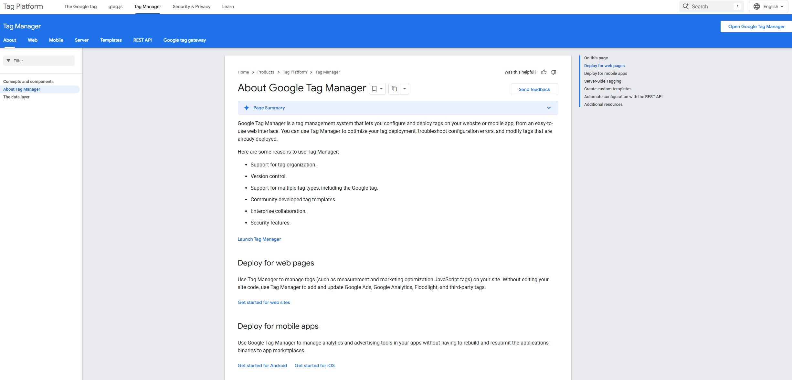
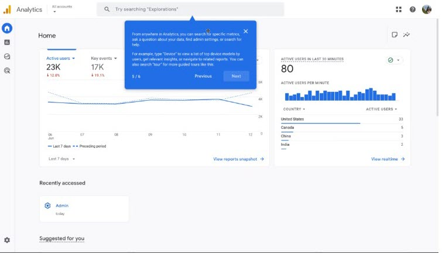

# Bard na nGleann Example Projects

## Google Analytics Help Center Management

This work focused on maintaining and updating Google product help center content to keep documentation aligned with feature releases and user needs. I worked across the full suite of Google Analytics documentation and supported continuous improvement of help content.

Example articles can be made available upon request.

---

## Developer and API Documentation

I authored developer-facing documentation for Google Tag Manager and Ads Data Hub, with a focus on making complex integrations easier to understand and implement.

---

## UI Flow Design for Feature Onboarding

This work centred on designing user onboarding flows and product guidance for new Google Analytics features, helping users understand and adopt functionality more quickly.

---
