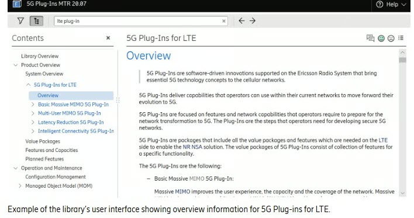

# Sidero Sample Projects

## Ericsson Network Manager Documentation Delivery

I managed documentation for Ericsson Network Manager in a DITA-based environment, supporting release-ready content aligned with sprint-based product delivery. I also worked on the migration of content from Confluence to a new CMS.

---

## DITA CMS Web Editor Rollout

This work focused on rolling out a lightweight DITA CMS web editor to developer teams, improving authoring efficiency and making structured authoring more accessible across multiple teams.

---

## Agile Documentation Delivery

I worked closely with the documentation team to set up a Kanban board for documentation tasks. 

---
